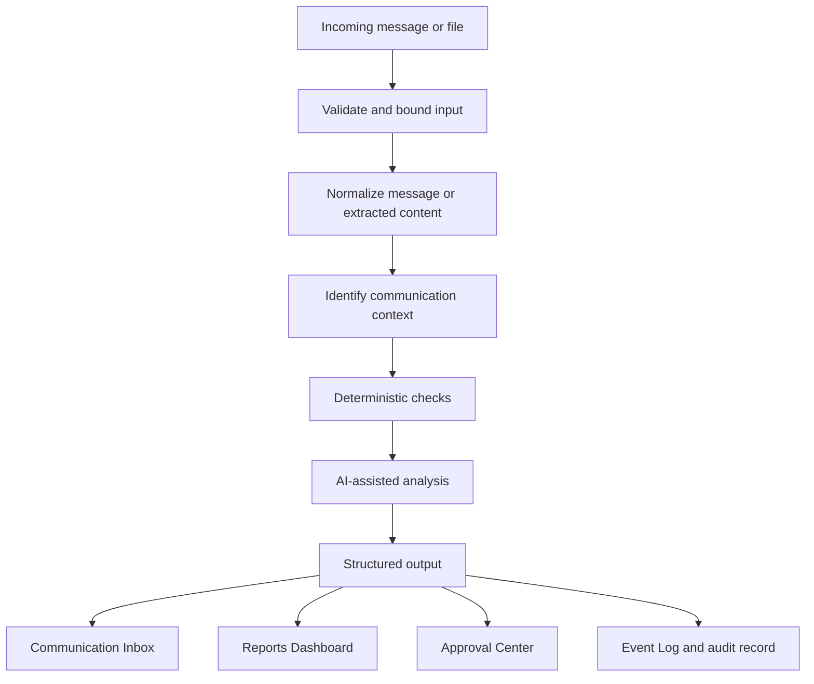

# AgenticOps AI

## Communication Intelligence Platform

## Technical White Paper

## Version 1.0

Date: July 24, 2026

---

# Executive Summary

AgenticOps AI is an AI-powered Communication Intelligence Platform that helps organizations analyze communications across multiple channels using deterministic security rules, AI reasoning, explainable risk scoring, confidence scoring, and human approval workflows.

Modern organizations receive important conversations across community platforms, email, social channels, support channels, documents, spreadsheets, and internal collaboration tools. These communications contain operational signals, customer intent, risk indicators, fraud attempts, support issues, complaints, sales opportunities, and security threats. Most teams still review this information manually or through fragmented tools that do not share a common message model, audit trail, or safety boundary.

AgenticOps AI addresses this gap by providing one unified analysis engine. Version 1.0 includes two implemented communication contexts: Web3 Community Security and Business Communication Intelligence. It also includes connected communication ingestion foundations, document intelligence for supported file types, a Communication Inbox, an Approval Center, event logs, reports, and durable workflow storage.

The platform is built around a safety-first operating model. It analyzes messages, explains why a risk or recommendation was produced, generates suggested response guidance, and requires human review for sensitive or external actions. AgenticOps AI does not autonomously send emails, reply to communities, moderate users, spend money, modify inboxes, or launch campaigns.

# The Problem

Organizations increasingly operate across fragmented communication channels. Customer conversations, security incidents, operational issues, and business records are spread across email, Telegram, Discord, Facebook Messenger, Instagram, uploaded documents, spreadsheets, and manual workflows.

This fragmentation creates several problems:

- Web3 scams and phishing campaigns move quickly through community channels.
- Social engineering attacks often imitate administrators, support teams, wallet recovery flows, or trusted brands.
- Manual moderation is slow, inconsistent, and hard to audit.
- Business communication overload makes it difficult to identify urgent requests, complaints, leads, risk indicators, and follow-up actions.
- Documents and spreadsheets contain important business signals, but they are rarely analyzed together with communication records.
- Teams lack centralized communication intelligence that can normalize messages, analyze context, explain risk, and preserve review history.

The result is operational risk. Teams may miss scams, respond inconsistently, overlook customer intent, or make decisions without a clear audit trail.

# The Solution

AgenticOps AI provides one unified intelligence engine capable of analyzing communications from multiple inputs and channels through a shared pipeline.

The platform combines:

- Deterministic rules for stable, explainable security decisions.
- AI reasoning for classification, summarization, sentiment, intent, priority, and recommended actions.
- Structured outputs that are safe for dashboards, integrations, reports, and external AI systems.
- Confidence scoring to help users understand uncertainty.
- Human review workflows so recommendations remain controlled and auditable.

Every supported message or document is normalized before analysis. The system then identifies the communication context, applies deterministic checks where appropriate, runs AI-assisted reasoning, and returns explainable results. This architecture allows AgenticOps AI to support Web3 Community Security, Business Communication Intelligence, connected integrations, document analysis, and future expansion without creating separate one-off engines for every channel.

# Current Platform

This section documents only capabilities that exist in Version 1.0.

## Implemented Communication Contexts

- Web3 Community Security
- Business Communication Intelligence

## Implemented Workspaces and Views

- Communication Inbox
- Human Approval Center
- Event Log
- Reports Dashboard
- Knowledge Hub
- Integrations and AI Workspace
- Business Intelligence Workspace
- Web3 security demo and reports

## Implemented File and Document Intelligence

- TXT analysis
- PDF analysis for text-based PDFs
- DOCX analysis
- CSV analysis
- XLSX analysis

The platform does not claim OCR for scanned PDFs, macro execution, certified accounting audit, legal advice, or autonomous business execution.

## Implemented Communication Integrations

- Gmail integration with readonly access
- Telegram webhook integration
- Facebook Messenger integration
- Instagram integration foundation
- Discord Gateway worker

Gmail remains readonly. Discord processing runs through a persistent worker. Telegram and Meta webhook handling operate in analyze-only or approval-required mode. Instagram support is described as a foundation where production event coverage depends on provider delivery, account configuration, and permissions.

## Implemented Intelligence Outputs

- Explainable AI-assisted analysis
- Deterministic risk scoring for Web3 security rules
- Confidence scoring
- Risk signals
- Intent and sentiment where supported
- Recommended actions
- Suggested reply outlines
- Human review recommendations
- Batch analysis and reports
- Durable integration event and workflow persistence using Upstash KV

# AI Reasoning

AgenticOps AI uses a layered reasoning model:

Deterministic Rules + OpenRouter LLM Reasoning + Human Approval

Deterministic rules provide stable, reproducible signals. For example, requests for seed phrases, private keys, fake administrator contact, suspicious links, remote access, OTPs, passwords, prompt injection, and spam are detected through explicit rule logic. These rules produce rule IDs, severity, evidence, and recommended actions.

OpenRouter-backed LLM reasoning adds classification, summarization, intent, sentiment, confidence, and response guidance. AI reasoning is useful because many communications are ambiguous, context-dependent, or operational rather than purely security-related.

Human approval is the final safety boundary. Suggested replies and suggested actions remain internal recommendations unless explicitly approved through a controlled workflow. Version 1.0 does not execute autonomous external actions.

Explainability matters because organizations need to know why a message was classified as risky, urgent, or high priority. AgenticOps AI surfaces deterministic rule matches, confidence scores, risk signals, and written explanations so human reviewers can make informed decisions.

# Architecture

AgenticOps AI uses a provider-neutral communication pipeline. Each source adapter converts external or uploaded content into internal structures before analysis.



## Pipeline Stages

1. Message or file ingestion receives manual text, supported files, Gmail messages, Telegram updates, Discord messages, Facebook Messenger events, or supported Instagram events.
2. Validation enforces bounded inputs, supported file types, and safe parsing constraints.
3. Normalization converts provider-specific payloads into a shared internal model.
4. Context identification separates Web3 security, business communication, email, social, and general contexts where supported.
5. Deterministic checks run stable security rules where applicable.
6. AI-assisted analysis produces structured intelligence.
7. Outputs are shown in dashboards, reports, inboxes, event logs, and approval workflows.
8. Human review remains required for sensitive recommendations and any future external execution.

# MCP Service

AgenticOps AI exposes an A2MCP-compatible Communication Intelligence service for external AI systems.

Production endpoints:

- MCP endpoint: `https://agenticopsai.xyz/api/mcp`
- Analysis endpoint: `https://agenticopsai.xyz/api/okx/analyze`
- Health endpoint: `https://agenticopsai.xyz/api/v1/health`

Callable tool:

- `analyze_communication_risk`

External AI systems can call the MCP endpoint to discover the available tool and invoke message analysis. The service accepts bounded message content, communication context, and source channel. It returns summary, intent, sentiment, priority, risk level, risk signals, recommended action, suggested reply outline, human-review requirement, confidence, and explanation.

The MCP service is analyze-only. It does not expose Gmail synchronization, OAuth operations, provider credentials, private integration events, approval mutation, or autonomous execution.

# Security

Version 1.0 applies several security controls:

- Bounded public input sizes.
- Zod validation for structured requests and responses.
- Sanitized API errors.
- No committed secrets.
- Server-only provider credentials.
- Gmail readonly scope only.
- Encrypted durable OAuth-token storage for Google tokens.
- Webhook validation for supported providers.
- Telegram secret-token validation.
- Discord internal-secret validation.
- Meta signature validation where app secret is available.
- No raw OAuth tokens exposed to the browser.
- No autonomous replies, moderation, inbox mutation, ad actions, or payment actions.
- Human approval for recommendations and future external actions.

The platform stores bounded analysis data and workflow records where durable repositories are configured. It avoids storing raw provider payloads or unbounded private message bodies by default.

# Technical Stack

Version 1.0 uses:

- Next.js App Router
- React
- TypeScript
- Tailwind CSS
- Zod
- OpenAI-compatible client configured for OpenRouter-compatible LLM reasoning
- Upstash Redis / Vercel KV for durable integration events and workflows
- Encrypted OAuth token storage for Google tokens
- Gmail API with `gmail.readonly`
- Telegram webhook processing
- Meta webhook processing for Facebook Messenger and Instagram foundation events
- Discord.js Gateway worker for persistent Discord ingestion
- Node.js worker runtime for Discord deployment
- Maintained document parsing libraries for TXT, PDF, DOCX, CSV, and XLSX workflows
- Vitest, ESLint, TypeScript checking, and production smoke tests

# Current Deployment

Production website:

- `https://agenticopsai.xyz`

Production service endpoints:

- `https://agenticopsai.xyz/api/mcp`
- `https://agenticopsai.xyz/api/okx/analyze`
- `https://agenticopsai.xyz/api/v1/health`

Version 1.0 production validation included:

- Build validation
- Lint validation
- TypeScript typecheck
- Unit tests
- Endpoint validation
- Production smoke verification against the custom production domain

The Next.js application is deployed on Vercel. The Discord Gateway worker runs separately as a persistent service. Durable integration event storage uses Upstash KV / Vercel KV configuration.

# Use Cases

## Web3 Communities

Detect scams, phishing, fake administrators, wallet-risk patterns, credential requests, suspicious links, and social engineering. Generate explainable moderator guidance for human review.

## Business Operations

Analyze communications and uploaded business files for intent, priority, risk, requested actions, missing context, and recommended next steps.

## Customer Support

Identify support requests, complaints, urgency, sentiment, missing information, and escalation needs.

## Fraud Detection

Surface phishing indicators, credential requests, social engineering patterns, impersonation, and suspicious action requests.

## Operational Risk

Review business communications, documents, spreadsheets, and budget records for preliminary risk indicators, anomalies, missing information, and follow-up questions.

## Communication Intelligence

Normalize communications from supported sources into one pipeline for structured analysis, inbox views, reports, event logs, and approval workflows.

# OKX Integration

AgenticOps AI exposes an A2MCP-compatible Communication Intelligence service.

Current callable tool:

- `analyze_communication_risk`

The service has been submitted to OKX for review. This white paper does not claim OKX approval or public listing until review is complete.

The submitted service is analyze-only and uses:

- MCP endpoint: `https://agenticopsai.xyz/api/mcp`
- Service name: Communication Intelligence
- Fee: 0 USDT
- Human-review boundary: required for suggested actions and external execution

# Future Roadmap (Planned Features)

Everything in this section is planned future work unless separately marked implemented elsewhere in the product.

## Communication Channels

- X (Twitter)
- LinkedIn
- Slack
- Microsoft Teams
- WhatsApp Business

## Social Intelligence

- Social comment intelligence
- Direct message intelligence
- Brand monitoring
- Reputation analytics

## Marketing Intelligence

- Social ad management with human approval
- AI marketing intelligence

## Business Operations

- Gmail send/modify actions with user approval
- Calendar intelligence
- Workflow automation

## Enterprise

- BigQuery integration
- Google Cloud integrations
- Business intelligence expansion

## AI Platform

- Multiple LLM providers
- AI agent orchestration
- AI business operator

# Conclusion

AgenticOps AI is a Communication Intelligence Platform designed to help teams understand, prioritize, and safely respond to modern communications. Version 1.0 represents the first production release: Web3 Community Security, Business Communication Intelligence, connected ingestion foundations, document analysis, explainable AI outputs, reports, event logs, and human approval workflows.

The long-term vision is a broader AI operations layer for communication, business intelligence, audit, compliance, marketing, and workflow automation. The Version 1.0 boundary remains clear: analyze communications, explain risk, recommend actions, and keep humans in control.

# Appendix

## API Example

```bash
curl -X POST https://agenticopsai.xyz/api/okx/analyze \
  -H "content-type: application/json" \
  -d '{
    "content": "Urgent wallet verification. Send your seed phrase now.",
    "context": "web3-community",
    "source": "telegram"
  }'
```

## API Response Example

```json
{
  "summary": "AI analysis failed; deterministic result was preserved.",
  "intent": "General Communication review",
  "sentiment": "neutral",
  "priority": "critical",
  "riskLevel": "critical",
  "riskSignals": ["SEC-001: Seed phrase or recovery phrase request"],
  "recommendedAction": "Use deterministic security results only and escalate for human review.",
  "suggestedReplyOutline": "Suggested reply for human review: Do not share seed phrases, private keys, passwords, OTP codes or payment details.",
  "requiresHumanReview": true,
  "confidence": 0,
  "explanation": "Source telegram was treated as untrusted input. Deterministic risk was CRITICAL."
}
```

## MCP Example

```json
{
  "jsonrpc": "2.0",
  "id": 1,
  "method": "tools/call",
  "params": {
    "name": "analyze_communication_risk",
    "arguments": {
      "content": "Fake admin asks for a private key.",
      "context": "web3-community",
      "source": "discord"
    }
  }
}
```

## Glossary

- A2MCP: Agent-to-MCP service mode for exposing a callable tool to external AI systems.
- Communication Intelligence: Structured analysis of message content, context, risk, priority, sentiment, and recommended action.
- Deterministic Rule: A stable rule that produces reproducible security signals without relying on model judgment.
- Human Approval: A workflow boundary requiring a person to review recommendations before external action.
- MCP: Model Context Protocol-style interface for tool discovery and invocation.
- Normalized Message: Provider-neutral representation of communication content before analysis.
- Upstash KV: Durable key-value storage used for integration events and workflow records.

## Architecture References

- `docs/architecture.md`
- `docs/implementation-plan.md`
- `docs/okx-submission.md`
- `docs/api-testing.md`
- `lib/messages/`
- `lib/integrations/`
- `lib/security/`
- `lib/analysis/`
- `lib/business/`
